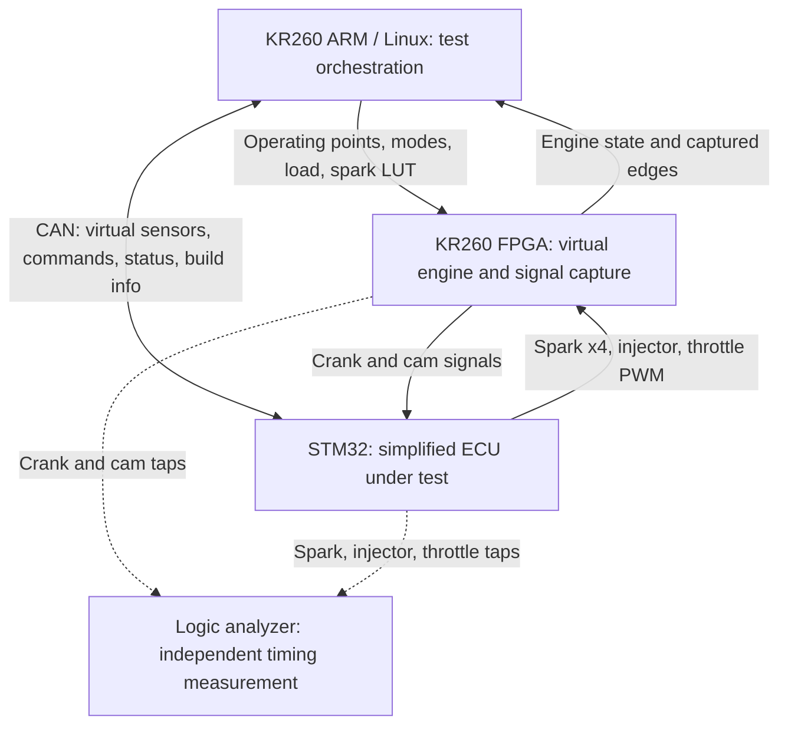

# EngineLoop — FPGA-Based Engine HIL Testbench

An FPGA-based virtual engine and automated hardware-in-the-loop test bench for a simplified STM32 engine controller.

[Architecture](docs/architecture.md) · [Interface spec](docs/interface_spec.md) · [Register map](docs/register_map.md) · [Roadmap](docs/roadmap.md) · [Validation](docs/validation.md) · [Toolchain & bench](docs/toolchain_and_bench.md)

[](https://github.com/AlexSun0401/engineloop-hil/actions/workflows/checks.yml)

> **Status: planning and repository scaffolding.** The repository contains the proposed architecture, interfaces, a draft CAN DBC, and implementation milestones. No engine model, FPGA design, ECU firmware, or hardware test results have been implemented or validated yet. All performance numbers and pass criteria are proposed targets. The only executable checks are documentation-link and DBC checks.

## Purpose

v1 is an **ECU timing and regression test platform with a narrow, data-backed torque model**. The KR260 represents the engine, an STM32 runs the controller under test, and Linux/Python configures operating points and evaluates the controller's actual electrical outputs.

The main demonstration is an automated regression: a normal firmware build passes the eligible timing tests, a deliberately introduced +3° spark-timing error fails them, and a fixed build passes again.

## System overview



| Component | Planned responsibility |
| --- | --- |
| KR260 programmable logic (PL) | Generate 60-2 crank and cam signals, capture physical ECU outputs crank-synchronously, run the quantized torque model, update simulated speed |
| KR260 ARM processing system (PS) | Run Linux/Python, control the PL through registers, exchange CAN frames, flash firmware, run DOE sweeps, produce reports |
| STM32 controller | Decode engine position, schedule spark/injection, output throttle PWM, regulate idle speed, report build identity |
| CAN connection | Virtual sensor values, commands, ECU status ([draft DBC](interfaces/engineloop.dbc)); v1 uses a USB-to-CAN adapter on the KR260 |
| Logic analyzer | Cross-check selected physical timing measurements independently of the FPGA |

## How the feedback loop works

1. The FPGA generates crank and cam pulses representing engine position and speed.
2. The STM32 decodes those pulses and outputs spark, injector, and throttle signals.
3. The FPGA measures actual spark edges and throttle duty, compares spark with the shared reference table, and estimates torque from speed, air charge, and spark offset.
4. In free-run mode, engine torque minus external load changes simulated speed, which changes the next crank pulses.
5. Python evaluates recorded outputs against independently calculated timing references and records firmware, FPGA, model, and spark-table versions.

The injector output is captured for timing checks only in v1; it does not affect the engine model.

| Mode | Speed behavior | Intended use |
| --- | --- | --- |
| Dyno | Held at the setpoint; air charge can be set directly | Stable operating-point sweeps and timing verification |
| Free-run | Updated from net torque and assumed inertia | Idle-control and load-step demonstration |

## Engine model

Data: the EPA test data package for the 2016 Honda 1.5 L L15B7 engine (speed, torque, airflow, spark), with the ALPHA map for motoring drag and as a fallback source.

The surrogate is a single-output quantized `3 → 32 → 32 → 1` MLP converted with hls4ml. Inputs: speed, air charge per cycle, spark offset. Output: brake torque only — no torque-derived inputs. A lookup table is a fallback only, behind the same interface.

Measured steady-state data supports the base torque surface. The spark-offset response is a textbook torque-ratio curve, labelled as an assumption; inertia and air-path lag are assumed and not calibrated against transients. The model belongs to the virtual engine; the STM32 performs the control.

## Repository layout

```text
engineloop-hil/
├── docs/        Architecture, interface spec, register map, toolchain, roadmap, validation, progress
├── interfaces/  Shared machine-readable contracts (CAN DBC; later table schemas)
├── tools/       Repository checks (Markdown links, DBC), run in CI
├── data/        Public-data retrieval and processing (planned)
├── model/       Training, quantization, export, shared vectors (planned)
├── hls/         Notes for generated HLS work; generated projects ignored (planned)
├── fpga/        RTL, testbenches, constraints, Kria app packaging (planned)
├── fw/          STM32 controller firmware (planned)
├── host/        Test orchestration, CAN, analysis, reports (planned)
└── tests/       Validation cases and reference-vector checks (planned)
```

Each module directory has a README describing its purpose and planned work. These are boundaries for future implementation, not completed components.

## Implementation sequence

| Phase | Deliverable | Estimate (10–15 h/week) | Status |
| --- | --- | --- | --- |
| P0 | Interface spec, EPA training table, float baseline, bench smoke tests | 1–2 weeks | Not started |
| P1 | Single-output QAT MLP, hls4ml C simulation | 1–2 weeks | Not started |
| P2 | PL bring-up, one bitstream loaded as a Kria app | 3–4 weeks | Not started |
| P3 | STM32 firmware, CAN, `+3°` build flag | 2–3 weeks | Not started |
| P4 | Closed loop and regression report | 2–3 weeks | Not started |

See the [roadmap](docs/roadmap.md) for tasks, gates, and stretch goals, and the [progress log](docs/progress.md) for what has actually been done.

## Start here

1. Read the [architecture](docs/architecture.md) and the [interface spec](docs/interface_spec.md); accept or change each *Proposed* value.
2. Run the three [bench smoke tests](docs/toolchain_and_bench.md#first-bench-smoke-tests-recommended-during-p0) while starting the P0 data work.
3. Implement one bounded task, attach its evidence, and add a [progress](docs/progress.md) entry.

Check the repository locally:

```bash
python tools/check_md_links.py
pip install cantools && python tools/check_dbc.py interfaces/engineloop.dbc
```

There is no hardware build command yet; build and reproduction commands are added with their implementations.

## Evidence planned for the first complete demonstration

1. Float (and quantized) model vs held-out measured EPA points, with the tolerance and envelope stated.
2. hls4ml fixed-point vs float on shared vectors (≤ 0.5 % of range, no overflow).
3. On-board hardware vs HLS C simulation, bit-exact.
4. ECU timing by logic analyzer vs the interface spec (tolerance frozen before testing).
5. Normal / +3° faulty / fixed firmware comparison with per-point PASS, FAIL, or INVALID verdicts and a run manifest (commit, firmware build, bitstream, model and spark-table hashes).
6. An idle load-step plot labelled as a demonstration under assumed plant dynamics.

No results or performance badges are published at this stage.

## Scope and limitations

This is a simplified educational HIL bench. It is not a validated combustion model or a production ECU qualification platform. Fuel dynamics, knock, emissions, turbo dynamics, and calibrated transient behavior are outside v1 scope. No proprietary employer data, or values fitted from it, is part of this repository.

## Sources and license

The plan follows the owner's KR260 Engine HIL build guide and the agreed plan revision 2 (both 2026-11-01). Public references are in [docs/references.md](docs/references.md). Contribution rules are in [CONTRIBUTING.md](CONTRIBUTING.md).

An open-source license has not been selected yet; until one is added, all rights are reserved by default. Third-party data and tools keep their own terms.
