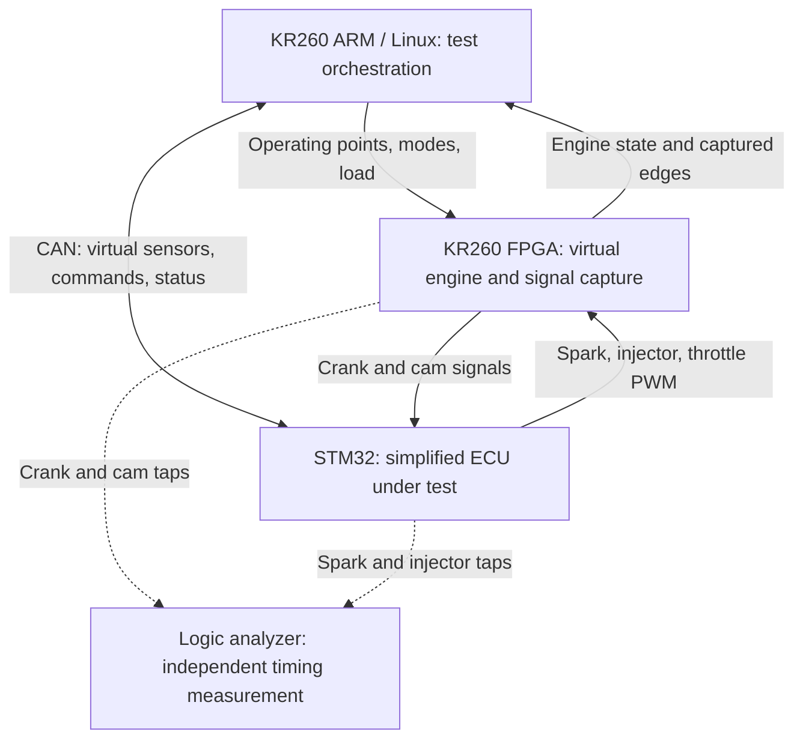

# EngineLoop — FPGA-Based Engine HIL Testbench

An FPGA-based virtual engine and automated hardware-in-the-loop test bench for a simplified STM32 engine controller.

[Architecture](docs/architecture.md) · [Roadmap](docs/roadmap.md) · [Validation](docs/validation.md) · [Repository setup](docs/repository_setup.md)

> **Status: planning and repository scaffolding.** This repository currently contains the proposed architecture, module boundaries, interfaces, and implementation milestones. No engine model, FPGA design, ECU firmware, or hardware test results have been implemented or validated yet. All performance numbers and pass criteria in the design documents are proposed targets.

## Purpose

Develop a repeatable way to test engine-controller firmware on a desk. The KR260 represents the engine, an STM32 runs the controller under test, and Linux/Python configures operating points and evaluates the controller's actual electrical outputs.

The main demonstration will be an automated regression: a normal firmware build passes the eligible timing tests, a deliberately introduced +3° spark-timing error fails them, and a corrected build passes again.

## System overview



| Component | Planned responsibility |
| --- | --- |
| KR260 programmable logic (PL) | Generate crank/cam signals, capture physical ECU outputs, estimate air charge and torque, update simulated speed |
| KR260 ARM processing system (PS) | Run Linux/Python, control the PL through registers, exchange CAN frames, flash firmware, run sweeps, produce reports |
| STM32 controller | Decode engine position, schedule spark/injection, output throttle PWM, and regulate idle speed |
| CAN connection | Carry virtual sensor values, pedal commands, and ECU status; v1 uses a USB-to-CAN adapter on the KR260 |
| Logic analyzer | Cross-check selected physical timing measurements independently of the FPGA |

## How the feedback loop works

1. The FPGA generates crank and cam pulses representing engine position and speed.
2. The STM32 decodes those pulses and outputs spark, injector, and throttle signals.
3. The FPGA measures actual spark edges and throttle duty. The plant uses measured spark timing and throttle-derived air charge to estimate torque.
4. In free-run mode, engine torque minus external load changes simulated speed, which changes the next crank pulses.
5. Python evaluates recorded outputs against independently calculated timing references and records the firmware and FPGA/model versions.

The injector output is captured for timing checks only in v1; it does not affect the engine model.

### Two operating modes

| Mode | Speed behavior | Intended use |
| --- | --- | --- |
| Dyno | Held at the requested setpoint | Stable operating-point sweeps and timing verification |
| Free-run | Updated from net torque and assumed inertia | Idle-control and load-step demonstration |

## Engine model

The planned data source is the EPA's public 2016 Honda 1.5 L L15B7 engine dataset. A small torque surrogate will take engine speed, air charge per cycle, and spark offset relative to a reference timing surface as inputs.

The proposed implementation is a quantized `3 → 32 → 32 → 1` neural network converted with hls4ml. A lookup-table implementation is the fallback. Both must follow the same input/output contract and validation vectors.

Measured steady-state data supports validation of the base torque surface. Spark-offset torque response is an explicit modeling assumption, and the assumed inertia and air-path lag have not been calibrated against measured transients. The model belongs to the virtual engine; the STM32 performs the control.

## Repository layout

```text
engineloop-hil/
├── docs/       Architecture, interface draft, roadmap, validation, progress
├── data/       Future public-data retrieval and processing
├── model/      Future training, quantization, export, shared vectors
├── hls/        Documentation for generated HLS work; generated projects ignored
├── fpga/       Future RTL, testbenches, constraints, and overlay
├── fw/         Future STM32 controller firmware
├── host/       Future test orchestration, CAN, analysis, and reports
└── tests/      Future validation cases and reference-vector checks
```

Each module directory has a README describing its purpose and planned next work. These directories are boundaries for future implementation, not completed components.

## Implementation sequence

| Phase | Deliverable | Current state |
| --- | --- | --- |
| P0 | Interface conventions, data provenance, grouped train/test split, float baseline | Not started |
| P1 | Quantized model and HLS numerical equivalence | Not started |
| P2 | FPGA signal generation, capture, plant integration, board bring-up | Not started |
| P3 | STM32 synchronization, timing, idle control, and CAN firmware | Not started |
| P4 | Automated sweeps, independent measurements, fault regression, reports | Not started |

See the [roadmap](docs/roadmap.md) for tasks and completion gates. Current documentation work is tracked separately in the [progress log](docs/progress.md).

## Start here

For the initial GitHub upload, extract the package and place its contents directly in the repository root. Follow [repository setup](docs/repository_setup.md) to preserve any existing repository history.

1. Read the [architecture](docs/architecture.md) and [draft interface specification](docs/interface_spec.md).
2. Start P0 by resolving the open conventions and confirming the public dataset's columns and units.
3. Implement one bounded task, attach the relevant evidence, and update the [progress log](docs/progress.md).

There is no runnable application or hardware build command yet. Build and reproduction commands will be added with their respective implementations.

## Evidence planned for the first complete demonstration

- Held-out measured-point torque errors, with the metric and supported envelope stated.
- Quantized/HLS and on-board numerical comparisons on the same shared vectors.
- Crank/cam and ECU timing captures, including selected logic-analyzer cross-checks.
- A normal / faulty / fixed firmware comparison with per-point PASS, FAIL, or INVALID verdicts.
- An idle load-step plot labeled as a demonstration under assumed plant dynamics.
- A reproducible run manifest with source commit, firmware build IDs, bitstream hash, and model hash.

No results or performance badges are published at this stage.

## Scope and limitations

This is a simplified educational HIL test bench. It is not a validated combustion model or a production ECU qualification platform. Fuel dynamics, knock, emissions, and calibrated transient behavior are outside v1 scope. No proprietary employer data is part of the initial repository.

The supported operating envelope, error thresholds, selected hardware pins, tool versions, and numerical formats must be confirmed during implementation. The [validation plan](docs/validation.md) explains which evidence can support each claim.

## Sources and updates

The initial plan follows the supplied **KR260 Engine HIL: Build Guide**, dated November 1, 2026. Public references from that guide are listed in [docs/references.md](docs/references.md).

Use the [contribution workflow](CONTRIBUTING.md) to add implementation and evidence in small increments. An open-source license has not been selected yet; third-party data and tools retain their own terms.
