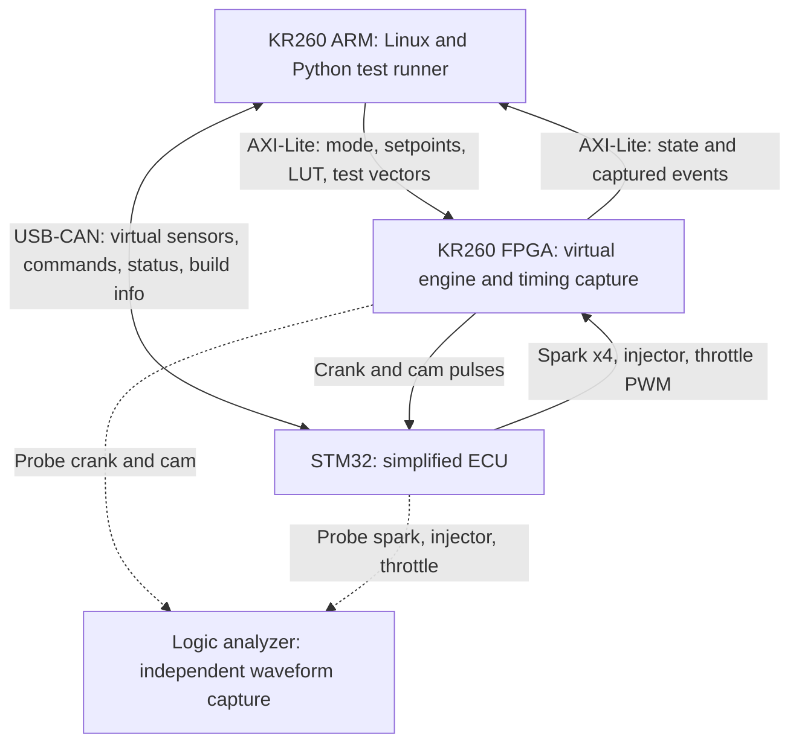
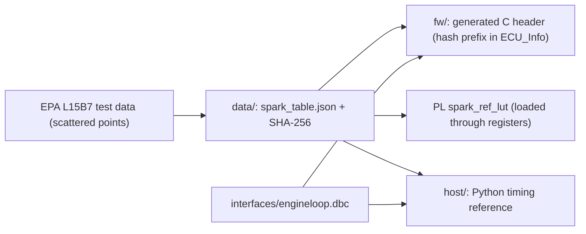

# System architecture

Status: design proposal. The blocks and flows below describe intended behavior; hardware, firmware, models, and test results have not been implemented or validated in this repository.

## Purpose

Build a small hardware-in-the-loop (HIL) rig that tests a real STM32 controller against a virtual engine on the KR260. v1 is an **ECU timing and regression test platform with a narrow, data-backed torque model**. Its primary result is repeatable ECU timing tests that distinguish normal firmware, firmware with an intentional +3° spark error, and a repaired version.

The STM32 is the device under test. The KR260 provides the simulated plant and test automation. A logic analyzer supplies an independent timing measurement.

## System boundary

CAN stays on the KR260 Linux side through a USB-to-CAN adapter in v1. The FPGA timing signals use direct 3.3 V logic connections on one PMOD. No real ignition coil, injector, throttle actuator, or combustion engine is connected.

## Responsibilities

| Component | Intended responsibility | Does not establish |
| --- | --- | --- |
| KR260 FPGA | Generate crank/cam signals, capture physical ECU outputs, compute spark offset against the reference table, estimate torque, update virtual speed | Physical accuracy of the assumed engine dynamics |
| STM32 firmware | Decode engine phase, schedule spark and injection, drive throttle PWM, run an idle PI controller, exchange CAN messages, report build identity | Compatibility with a production ECU |
| KR260 Linux/Python | Load the PL app, apply test conditions, send virtual sensor data, flash builds, check build identity, read measurements, evaluate results, generate reports | Deterministic pin-level timing by itself |
| Logic analyzer | Independently reconstruct selected spark and injection angles from captured waveforms | Accuracy of the torque model |
| Build workstation | Process data, train/export the model, build the FPGA design and firmware | Target-side execution of those development tools |

## Closed-loop dataflow

1. The FPGA converts virtual crank speed and phase into crank/cam pulses.
2. The STM32 estimates speed and engine phase from those pulses. It receives virtual air charge and test commands over CAN.
3. The STM32 schedules spark/injection edges and outputs throttle PWM.
4. The FPGA measures the actual output edges and PWM duty. The plant uses **captured** spark timing, never the ECU's reported command.
5. The air path converts throttle duty into air charge (or, in dyno mode with override, air charge comes from a register). The FPGA looks up the reference spark for the current speed and air charge, forms the spark offset, and the torque surrogate estimates brake torque from speed, air charge, and spark offset.
6. In free-run mode, net torque changes virtual speed once per firing event. The updated speed changes the next crank pulses, closing the loop.

Injection is captured for timing checks only. Fuel flow and injection pulse width do not affect the v1 plant torque.

### Operating modes

| Mode | Speed behavior | ECU mode | Intended use |
| --- | --- | --- | --- |
| Dyno | Held at a selected setpoint; air charge from override register or air path | `PEDAL` (idle PI off, so it cannot wind up against a held speed) | Stable timing sweeps and the normal/faulty/fixed regression |
| Free-run | Updated from engine torque, load torque, and assumed inertia | `IDLE_PI` | Idle-control demonstration with external load steps |
| Vector test | Model inputs supplied through registers | Any | Compare model outputs across software, HLS simulation, and FPGA hardware |

The free-run demonstration is separate from the primary steady-state timing verdicts. A load-step plot does not validate real-engine transient behavior.

## FPGA blocks

| Planned module | Input | Output and role |
| --- | --- | --- |
| `crank_gen` | Virtual speed and phase accumulator | 60-2 crank signal and one cam pulse per 720° cycle, per [interface_spec.md](interface_spec.md) |
| `edge_capture` | Physical spark/injector edges, current phase | Latency-compensated angle + 64-bit timestamp events in a FIFO, with channel and edge polarity |
| `pwm_meas` | Physical throttle PWM | Measured duty and period |
| `airpath` | Duty and speed | Air charge = duty × max-air(rpm) through an assumed first-order lag; bypassed by the override in dyno mode |
| `spark_ref_lut` | Speed, air charge | Reference spark from the shared spark table (BRAM loaded by the host) |
| `torque_core` | Speed, air charge, spark offset | Torque estimate, envelope status, completion status (hls4ml IP) |
| `dynamics` | Engine torque, load torque, inertia | Updated speed per firing event in free-run; setpoint in dyno |
| `hil_regs` | AXI-Lite transactions | Registers per [register_map.md](register_map.md) |

Because the FPGA generates the crank signal from its own phase accumulator, a captured edge's angle is read from that accumulator directly; no tooth interpolation is needed on the plant side.

Bring-up order inside P2: first the trigger and capture path (`crank_gen`, `edge_capture`, `pwm_meas`, `hil_regs`), which is all the STM32 work in P3 needs; then the plant path (`airpath`, `spark_ref_lut`, `torque_core`, `dynamics`).

## Shared artifacts

One generated file feeds several consumers so they cannot drift apart:

The same applies to model test vectors: one saved set in `model/vectors/` is used by float, quantized, HLS C simulation, RTL simulation, and board checks.

## Torque-model path

Data: the EPA test data package for the 2016 Honda 1.5 L L15B7 (speed, torque, airflow, spark); the ALPHA map for motoring drag and as a fallback source. Only a defined stoichiometric steady-state region is used in v1.

The proposed surrogate is a small single-output `3 -> 32 -> 32 -> 1` MLP (about 1,200 parameters):

- Inputs: engine speed, air mass per engine cycle, and spark offset. No torque-derived inputs (BMEP, power, efficiency).
- Output: brake torque only.
- Deployment: quantization-aware training followed by hls4ml/HLS conversion.
- Fallback only (not a second deliverable): a speed/air-charge lookup table with a separate spark-efficiency factor, behind the same interface.

Measured rows provide the zero-offset torque reference. Spark-offset rows are generated from a textbook torque-ratio curve, labelled as an assumption; they are not measured spark sweeps. All augmented rows from one operating point stay in the same training or held-out group.

Accuracy is reported only on held-out measured points. Numeric agreement between Python, HLS simulation, and hardware is a separate check.

### Modeling assumptions (labelled, not validated)

- Spark response follows a textbook torque-ratio curve centered on stock spark, i.e. stock spark is treated as MBT. In knock-limited regions this understates the torque gain from advance.
- The engine is turbocharged and has variable cam timing; the model represents the stock boost and cam schedules implicitly through speed and air charge. Turbo spool dynamics are not modeled — air charge follows one first-order lag.
- Inertia `J` and air-path lag `tau_air` are assumed values.
- Torque is a cycle-mean value per firing event; no intra-cycle pulsation.

## Test and evidence flow

For each DOE point, the runner checks the envelope, sets conditions, waits for settling, captures a defined number of cycles, and compares physical output timing against an independently computed Python reference. It records `PASS`, `FAIL`, or `INVALID` with a reason. Before any sweep it checks the ECU's reported build hash, variant, and spark-table hash against the expected build.

The reference uses the shared spark table and the specified interpolation method, implemented independently of the ECU's C code, with the air-charge value the ECU actually received over CAN. Selected points are also checked with the logic analyzer so the verdict does not rely only on the FPGA's own generator and capture logic.

| Firmware | Intentional spark offset | Expected result |
| --- | --- | --- |
| Normal | 0° | In-envelope timing points pass |
| Faulty | +3° advance | The same points fail with about +3° error |
| Fixed | Offset removed | The same points pass again |

These are expected outcomes, not existing measurements. Reports identify the source commit, ECU build, bitstream hash, model hash, spark-table hash, input-point table, and capture artifacts.

## Scope limits

- The controller is a self-built simplified ECU, not a production ECU.
- Spark response, rotational inertia, and air-path lag are explicit assumptions.
- Reference engine data are public EPA Honda data; no employer engine data or values fitted from them are included.
- No combustion, knock, emissions, fuel-system, or actuator-power-stage model in v1.
- Out-of-envelope or unsettled points cannot count as successful tests.

See [the draft interface specification](interface_spec.md) for conventions that must be agreed before implementation.
