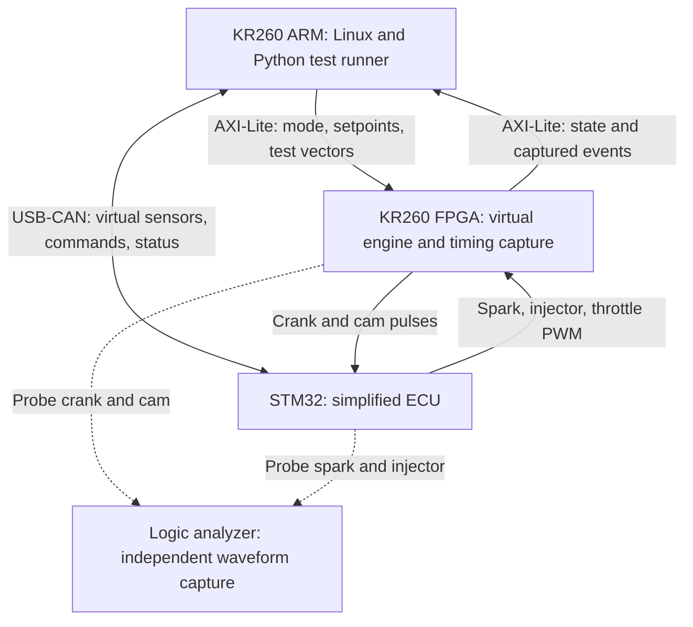

# System architecture

Status: design proposal. The blocks and flows below describe intended behavior; hardware, firmware, models, and test results have not been implemented or validated in this repository.

## Purpose

Build a small hardware-in-the-loop (HIL) rig that tests a real STM32 controller against a virtual engine on the KR260. The primary result will be repeatable ECU timing tests that distinguish normal firmware, firmware with an intentional spark-angle error, and a repaired version.

The STM32 is the device under test. The KR260 provides the simulated plant and test automation. A logic analyzer supplies an independent timing measurement.

## System boundary

CAN stays on the KR260 Linux side through a USB-to-CAN adapter in v1. The FPGA timing signals use direct 3.3 V logic connections. No real ignition coil, injector, throttle actuator, or combustion engine is connected.

## Responsibilities

| Component | Intended responsibility | Does not establish |
| --- | --- | --- |
| KR260 FPGA | Generate crank/cam signals, capture physical ECU outputs, estimate torque, and update virtual speed | Physical accuracy of the assumed engine dynamics |
| STM32 firmware | Decode engine phase, schedule spark and injection, drive throttle PWM, run an idle PI controller, and exchange CAN messages | Compatibility with a production ECU |
| KR260 Linux/Python | Apply test conditions, send virtual sensor data, flash builds, read measurements, evaluate results, and generate reports | Deterministic pin-level timing by itself |
| Logic analyzer | Independently reconstruct selected spark and injection angles from captured waveforms | Accuracy of the torque model |
| Build workstation | Train/export the model and build the FPGA design and firmware | Target-side execution of those development tools |

## Closed-loop dataflow

1. The FPGA converts virtual crank speed and phase into crank/cam pulses.
2. The STM32 estimates speed and engine phase from those pulses. It receives virtual air charge and test commands over CAN.
3. The STM32 schedules spark/injection edges and outputs throttle PWM.
4. The FPGA measures the actual output edges and PWM duty. The plant must use captured spark timing, rather than trusting the ECU's reported command.
5. An air-path model converts throttle duty into air charge. A torque surrogate estimates brake torque from speed, air charge, and spark offset relative to reference timing.
6. In free-run mode, net torque changes virtual speed. The updated speed changes the next crank pulses, closing the loop.

Injection is captured for timing checks only. Fuel flow and injection pulse width do not affect the v1 plant torque.

### Operating modes

| Mode | Speed behavior | Intended use |
| --- | --- | --- |
| Dyno | Held at a selected setpoint | Stable timing sweeps and the normal/faulty/fixed regression |
| Free-run | Updated from engine torque, load torque, and assumed inertia | Idle-control demonstration with external load steps |
| Vector test | Model inputs supplied through registers | Compare model outputs across software, HLS simulation, and FPGA hardware |

The free-run demonstration is separate from the primary steady-state timing verdicts. A load-step plot does not validate real-engine transient behavior.

## FPGA blocks

| Planned module | Input | Output and role |
| --- | --- | --- |
| `crank_gen` | Virtual speed and phase configuration | 60-2 crank signal and one cam reference per 720-degree cycle |
| `edge_capture` | Physical spark/injector edges and current phase | Timestamped events in a FIFO, including channel and edge polarity |
| `pwm_meas` | Physical throttle PWM | Measured duty and period |
| `airpath` | Duty and speed | Air charge using a maximum-air-charge map and an assumed first-order lag |
| `torque_core` | Speed, air charge, and measured spark offset | Torque estimate, envelope status, and completion status |
| `dynamics` | Engine torque, load torque, and inertia | Updated speed in free-run mode; setpoint speed in dyno mode |
| `hil_regs` | AXI-Lite transactions | Configuration, state readout, vector testing, and event FIFO access |

The detailed event ordering, fixed-point formats, and register layout must be frozen before RTL and host software rely on them. In particular, a spark must be associated with the correct cylinder cycle before computing that event's torque.

## Torque-model path

The planned data source is the EPA test package and ALPHA maps for the 2016 Honda 1.5 L L15B7 engine. Only a defined stoichiometric steady-state region will be included in v1.

The proposed surrogate is a small `3 -> 32 -> 32 -> 1` MLP:

- Inputs: engine speed, air mass per engine cycle, and spark offset.
- Output: brake torque.
- Deployment: quantization-aware training followed by hls4ml/HLS conversion.
- Fallback: a speed/air-charge lookup table with interpolation and a separate spark-efficiency factor.

Measured rows provide the zero-offset torque reference. Additional spark-offset rows are generated from an assumed spark-efficiency relationship and must retain their provenance. They are not measured spark sweeps. All augmented rows from one operating-point group stay in the same training or held-out split.

Model accuracy will be reported on held-out measured rows. Numeric agreement between Python, HLS simulation, and hardware is a separate check from accuracy against measured data.

## Test and evidence flow

For each DOE point, the planned runner sets conditions, waits for settling, captures a defined number of cycles, and compares physical output timing against an independently computed Python reference. It records `PASS`, `FAIL`, or `INVALID` with a reason.

The reference computation uses the source timing data independently of the ECU's C lookup implementation. Selected points are also checked with the logic analyzer to avoid relying exclusively on the FPGA's own generator and capture logic.

The intended regression is:

| Firmware | Intentional spark offset | Expected result |
| --- | --- | --- |
| Normal | 0 degrees | In-envelope timing points pass |
| Faulty | +3 degrees advance | The same points fail with the corresponding timing error |
| Fixed | Offset removed | The same points pass again |

These are expected outcomes, not existing measurements. Future reports should identify the source commit, ECU build, bitstream hash, model hash, input-point table, and capture artifacts.

## Scope limits

- The controller is a self-built simplified ECU, not a production ECU.
- Spark-efficiency response, rotational inertia, and air-path lag contain explicit assumptions.
- Reference engine data is public EPA Honda data; no employer engine measurements are included.
- No combustion, knock, emissions, fuel-system, or actuator-power-stage model is included in v1.
- Out-of-envelope or unsettled points cannot count as successful accuracy tests.

See [the draft interface specification](interface_spec.md) for conventions that must be agreed before implementation.
